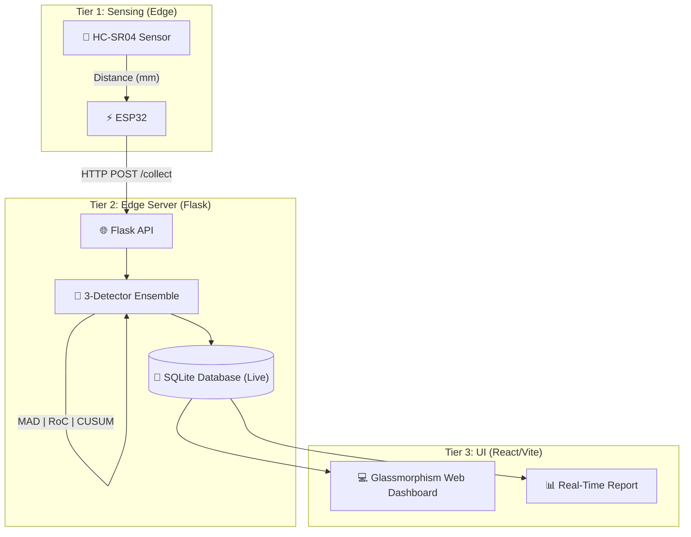
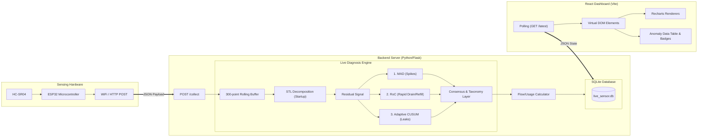
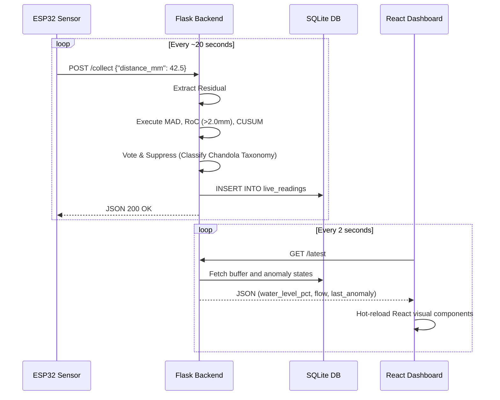

# 🛢 IoT Liquid Tank Monitoring with Anomaly Detection

A comprehensive IoT-based anomaly detection framework for liquid tank monitoring using HC-SR04 ultrasonic sensor, ESP32 microcontroller, and a robust 3-detector ensemble pipeline acting on STL-decomposed residuals.

## 🏗 Architecture



**Three-Tier System:**

- **Tier 1 (Sensing):** HC-SR04 + ESP32 emitting real-time proximity pings.
- **Tier 2 (Edge Server):** Flask backend evaluating residuals via median absolute deviations, contextual thresholds, and adaptive logic.
- **Tier 3 (Visualization):** React/Vite web application providing real-time flow summary, dynamic charting, and statistical reporting.

## 🔍 In-Depth System Architecture



## 🔄 User Flow & Data Lifecycle



## 🎯 Physical Calibration (Hardcoded Defaults)

- **Tank Full Capacity (100%)**: `35.0 mm` boundary from sensor.
- **Tank Empty Limit (0%)**: `395.0 mm` boundary from sensor.
- **Overflow Trigger**: `< 35.0 mm`

## 📊 Detection Methods

| Method                      | Target Anomaly   | Mechanism | Severity/Alert |
| --------------------------- | ---------------- | --------- | ------------- |
| MAD (Median Absolute Dev)   | Point Spikes     | Robust threshold against extreme math noise | Critical |
| RoC (Rate of Change)        | Drains / Theft   | Failsafe threshold bounds `±2.0mm/s` | Alert |
| RoC (Negative Limit)        | Refill Events    | Physical override mapping to Normal Op | Log |
| Adaptive CUSUM              | Slow Leaks       | Tracks progressive cumulative slip | Alert |
| **Hybrid (3-method)** | **Voting Consensus** | **n_agree / 3 determines tier** | **Dynamic** |

## 🚀 Quick Start

### 1. Start the Flask Backend

```bash
cd backend
pip install -r requirements.txt
python app.py
```
*Note: `app.py` runs on port `5001`. The `backend/simulator/replay.py` can be used to stream the included `Thursday_Tuesday.csv` directly into the `/collect` endpoint to visualize data locally.*

### 2. Start the React Frontend

```bash
cd frontend
npm install
npm run dev
```
*Note: Runs on port `5173`. Opens to a live dashboard rendering sensor streams mapped to the mathematical pipeline.*

## 📁 Project Structure

```text
tank_monitor_cloned/
├── backend/
│   ├── app.py                   # Main Flask API / Routing
│   ├── data/                    # Thursday_Tuesday.csv & SQLite local instance
│   ├── services/
│   │   ├── analysis.py          # Master aggregator + pipeline initialization
│   │   ├── anomaly.py           # MAD, CUSUM, Chandola Taxonomy Logic
│   │   ├── flow.py              # Time-to-Empty / Flow Rate logic
│   │   ├── roc.py               # Rate of change sliding window
│   │   └── stl.py               # Time-series decomposition
│   └── simulator/               # Synthetic event streaming
│       └── replay.py
├── frontend/
│   ├── src/
│   │   ├── components/          # Reusable Glassmorphism UI
│   │   ├── pages/
│   │   │   ├── Dashboard.jsx    # Real-time operations window
│   │   │   ├── Analytics.jsx    # Historical chart views
│   │   │   └── Report.jsx       # Read-only live statistical review
│   │   └── services/            # Axios API config
│   ├── package.json
│   └── vite.config.js           # Native build tooling
└── README.md
```

## 📈 Methodology Notes

- **Refill Logic Handling:** Standard `refill_events` mapped to negative RoC bursts are parsed correctly but are specifically downgraded to the `Log` severity tier. They automatically trigger an accelerated suppression circuit (2 hits instead of 5), recognizing massive level shifts natively as "Normal Application Operation", protecting against alert fatigue.
- **STL Application:** Detection is exclusively measured on mathematical **Residuals** rather than raw values, naturally eliminating daily water usage cycles that trigger false-positives in simpler moving average/standard-deviation models.
